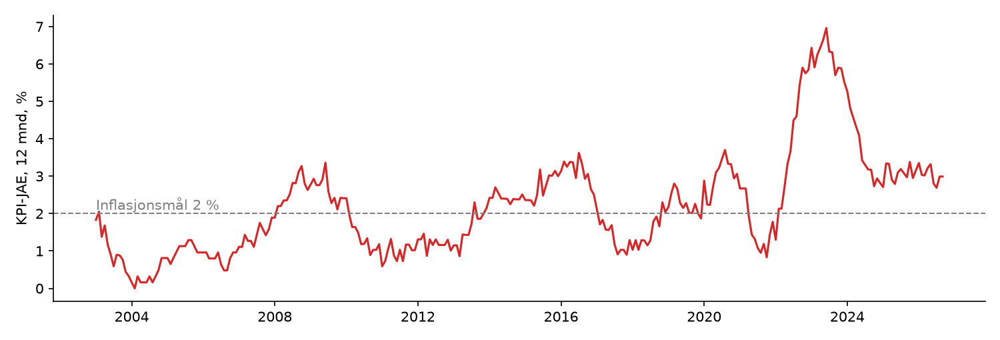

# Fra statistiske modeller til nevrale nettverk

[](https://colab.research.google.com/github/simeneide/how-to-train-your-ai/blob/main/workshop.ipynb)

Workshop, Tech Day, Norges Bank, 6. november 2026 (90 min). Simen Eide.

## Sammendrag

Norges Bank prognoserer inflasjonen med rundt 500 statistiske modeller i SMART. I denne workshopen bygger vi noen av de samme modelltypene på nytt i PyTorch: AR, VAR, BVAR og faktormodell. Så gjør vi dem om til nevrale nettverk, steg for steg. Poenget er at overgangen er liten: en AR-modell er et nevralt nett med ett lag, en Bayesiansk prior er det samme som regularisering, og en faktormodell er et skjult lag.

Deltakerne trenger ikke kode. Hver oppgave har et skjema med tall de endrer, og notebooken viser prognosen, feilen og en ledertavle. Vi avslutter med at hver modell gir en prognose for KPI-JAE i oktober, som SSB publiserer 10. november.

## Rammeverket: data, modell, trening, beslutning

Workshopen følger de samme fire stegene som foredraget om morgenen. Alle modeller, fra de Witts livrenter i 1671 til SMART og språkmodeller, består av de samme delene:

| Steg | Spørsmål | I workshopen | I SMART |
|---|---|---|---|
| **Data** | Hva vet vi? | ett felles datasett X, og `kolonner(...)` velger hvilke serier og hvor mange måneder tilbake | real-time-databasen med alle publiseringer |
| **Modell** | Hvordan henger det sammen? | `nn.Linear`, `nn.Sequential`: en funksjon med parametere | ~500 modeller i 15 ensembler |
| **Trening** | Hvilke parametere passer dataene best? | `train(...)`: treningsløkka, weight decay, valgt på validering | OLS, Bayesiansk estimering, vekting etter treff |
| **Beslutning** | Hva gjør vi med svaret? | ledertavla og prognosen for oktober | prognosen i Pengepolitisk rapport, og renten |

I hver oppgave er koden delt i de fire stegene, så det er lett å se hva du endrer: data (hvilke serier), modell (hvor stort nett), trening (hvor mye prior) eller beslutning (hvilken modell vi stoler på).

## Bakgrunn: KPI-JAE

KPI-JAE er konsumprisindeksen justert for avgiftsendringer og uten energivarer. Strøm og drivstoff svinger mye og sier lite om den underliggende prisveksten, og avgiftsendringer er politiske vedtak. Derfor er KPI-JAE et av de viktigste målene på underliggende inflasjon når Norges Bank setter renten mot inflasjonsmålet på 2 %.

SSB publiserer KPI-JAE månedlig, rundt den 10. i måneden etter. Norges Bank har regnet tilbake til 1979.



## Data

`data/forTecDay.xlsx` er fra Norges Bank og har de samme seriene som SMART Inflation bruker: 61 månedlige serier fra 1974, mange av dem først fra 2000-tallet. `data/forTecDay_dataset_summary.md` er beskrivelsen av alle seriene.

| Gruppe | Serier | Eksempel |
|---|---|---|
| KPI-JAE totalt | 3 | total, norskproduserte varer og tjenester, importerte konsumvarer |
| Hovedgrupper i KPI-JAE | 13 | matvarer, klær, bolig, transport, restaurant |
| Delindekser i KPI | 40 | husleie, kjøp av kjøretøy, flyreiser, pakkereiser |
| Drivere | 5 | kronekurs (I44), oljepris (Brent), internasjonale priser (IPK, IPI), registrert ledighet |

Slik ser dataene ut: ett utvalg av de 61 kolonnene, de seks siste månedene. Prisindeksene er sesongjusterte, med 2025 = 100.

| Måned | KPI-JAE | Norskprod. | Import | Mat (K1) | Restaurant (K11) | Husleie (K041) | Kronekurs (I44) | Brent | IPK | Ledighet % |
|:--|--:|--:|--:|--:|--:|--:|--:|--:|--:|--:|
| 2026M4 | 102.5 | 102.93 | 101.48 | 103.12 | 104.82 | 102.94 | 112.19 | 118.34 | 120.72 | 2.06 |
| 2026M5 | 102.8 | 103.06 | 102.32 | 102.67 | 105.24 | 103.14 | 110.07 | 107.99 | 120.91 | 2.05 |
| 2026M6 | 102.7 | 103.18 | 101.54 | 102.19 | 105.68 | 103.41 | 112.82 | 85.33 | 121.24 | 2.03 |
| 2026M7 | 102.9 | 103.50 | 101.46 | 102.09 | 105.92 | 103.77 | 113.48 | 84.09 | 121.75 | 2.05 |
| 2026M8 | 103.3 | 104.06 | 101.66 | 102.46 | 106.15 | 104.07 | 111.55 | 90.82 | 122.08 | 2.04 |
| 2026M9 | 103.5 | 104.49 | 101.31 | 103.55 | 106.50 | 104.30 | 110.32 | 113.92 | 122.54 | 2.02 |

- **KPI-JAE, Norskprod., Import:** totalen og de to leveringssektorene (`MSA_PCPIJAE`, `MSA_PCPIJAEI`, `MSA_PCPIJAEIMP`).
- **Mat, Restaurant:** to av de 13 hovedgruppene (`MSA_PCPIJAE_25_K1`, `_K11`). **Husleie:** én av de 40 delindeksene (`KPI.KPI.25.K041.IPR.S`).
- **Kronekurs (I44):** importveid kronekurs, høyere tall betyr svakere krone. **Brent:** oljeprisen. **IPK:** internasjonale priser på importerte konsumvarer. **Ledighet:** registrert ledighet fra NAV, i prosent.

Fra indeksnivåene regner vi ut endringen i prosent. For KPI-JAE i september 2026: 0,19 % fra august, og 2,99 % fra september i fjor.

I workshopen prognoserer vi **endringen fra én måned til neste**. Indeksen har én desimal, så månedsendringene hopper i trinn på omtrent 0,1 prosentpoeng. Det er en del av støyen ingen modell kan forklare.

Fallgruver i dataene (mer i beskrivelsen):
- Sesongjusteringen er gjort på forskjellige måter: X-12-ARIMA for totalen, FAME for hovedgruppene, SMART-modeller for delindeksene og NAV for ledigheten.
- Tre delindekser (K062, K064, K133) har ikke sesongmønster, så den justerte serien er lik den ujusterte.
- Kronekurs og oljepris er daglige serier som er gjort om til månedlige.

```python
import pandas as pd

d = pd.read_excel("data/forTecDay.xlsx").set_index("Time")  # Time: "2026M9"
d["MSA_PCPIJAE"].tail()  # KPI-JAE
```

## Hva SMART gjør

SMART (System for Model Analysis in Real Time) er Norges Banks plattform for kortsiktige prognoser. Den er beskrevet i [Staff Memo 7/2023, «A SMARTer way to forecast»](https://www.norges-bank.no/contentassets/cb3f5daec3d84de1a824239134b3ce1a/staff-memo-2023-7-smart.pdf). SMART Inflation har rundt 500 modeller i 15 grupper (ensembler) av fem typer:

| Modelltype | Antall | Hva den fanger | I workshopen |
|---|---|---|---|
| Univariate (AR o.l.) | ca. 200 | inflasjonens egen dynamikk, god på kort sikt | Oppgave 1: `nn.Linear(P, 1)` |
| Små VAR | over 100 | KPI-JAE sammen med én annen serie: olje, kurs, lønn, ledighet, PMI | Oppgave 2 |
| BVAR (Giannone-prior) | ca. 20 | større systemer, nyttige på lengre sikt | Oppgave 2: weight decay |
| Faktormodeller | 13 | felles bevegelser i mange serier | Oppgave 3: skjult lag |
| Enkeltlikninger (Phillipskurve, ARDL, ECM) | | økonomisk teori, betinget på Norges Banks egne prognoser | ikke med |

Modellene varierer i laglengde, transformasjoner og estimeringsvindu: noen bruker hele historien, andre et rullerende vindu på 10 år. Noen prognoserer KPI-JAE direkte, andre summerer opp fra norskproduserte og importerte varer, eller fra de 12 konsumgruppene.

Prognosene kombineres i flere trinn: først innenfor hver gruppe, så mellom gruppene.
- **Vekter etter treffsikkerhet:** hver modell får vekt omvendt proporsjonal med feilen (RMSE) den har hatt i prognosene sine.
- **Nylige treff teller mest:** feilene diskonteres med en faktor på 0,97 per periode, så et treff for 23 perioder siden teller halvparten.
- **Trimming:** de dårligste modellene får vekt null. Jo flere modeller i et trinn, jo større andel kuttes.

Resultatet: på kort sikt får univariate modeller, faktormodeller og små VAR mest vekt. På lengre sikt får BVAR og enkeltlikningene mer.

## Hvordan SMART valideres

SMART bedømmer alle modeller etter **hvor godt de har truffet på data de ikke har sett**, målt i sanntid:

1. **Bare det man visste den gangen.** SMART lagrer hver publisering av hver serie (vintage). Når modellene estimeres for en gitt dato, brukes bare dataene som var publisert da, med de revisjonene som fantes da. Før 2009 er dette rekonstruert (quasi-vintages).
2. **Prognoser utenfor utvalget.** For hver dato estimeres modellene på historien fram til da, og prognosen sammenlignes med det som faktisk skjedde. Feilen måles som RMSE per prognosehorisont, på firekvartalsveksten i KPI-JAE.
3. **Valideringen styrer vektene.** Den samme historiske feilen brukes til å vekte og trimme modellene, oppdatert hver gang det kommer nye tall.
4. **Sammenligning.** I memoet sammenlignes SMART med hvert ensemble alene, med det gamle systemet (SAM) og med prognosene i Pengepolitisk rapport, for 2003-2019. Enkelte ensembler er litt bedre på enkelthorisonter, men SMART er best samlet.

Workshopen forenkler dette:
- **Én fast deling** i stedet for rullerende sanntidsestimering: trening 2003-2016, validering 2017-2020 og test 2021-. Testperioden har inflasjonssjokket.
- **Én måned fram**, på månedsendringen.
- **Dagens versjon av dataene.** KPI revideres ikke, men sesongjusterte serier endrer seg litt når nye tall kommer. Vi bruker dagens versjon, så modellene ser en anelse mer enn man visste den gangen.
- **Velg på validering, mål på test.** Ledertavla sorteres etter valideringsfeil, slik SMART vekter etter historisk treff. Testfeilen viser om valget holdt.

## Oppgaver

1. **AR er et nevralt nett med ett lag:** `nn.Linear(P, 1)`, sammenlignet med OLS.
2. **VAR og prior:** flere serier gir overtilpasning, og weight decay (= BVAR-prior) hjelper.
3. **Fra faktormodell til nevralt nett:** skjult lag som flaskehals, så ReLU og dropout.
4. **Slå AR:** fri modell, valgt på valideringsfeil. Ledertavle og prognose for oktober-KPI.

Testet 2. november 2026 (RMSE på månedsendringen i testperioden): naiv 0,292, snitt siste 12 måneder 0,223, AR(12) 0,210, VAR med kronekurs, olje og importpriser 0,192, faktormodell 0,312.

## Kjøre notebooken

**Colab:** klikk på knappen øverst. Første celle henter datasettet fra GitHub. Så lenge repoet er privat, må du logge inn med GitHub i Colab for å åpne notebooken, og laste opp `data/forTecDay.xlsx` når cellen spør.

**Lokalt med uv (VS Code eller Jupyter):**

```sh
uv sync                           # lager .venv med Python 3.12, PyTorch, pandas osv.
code .                            # VS Code: åpne workshop.ipynb og velg kernel .venv
uv run --with jupyter jupyter lab # eller i nettleseren
```
